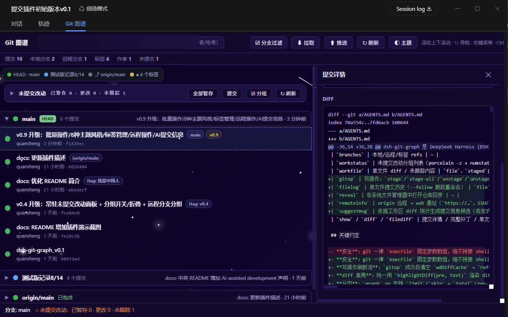

# dsh-git-graph

**DSH 里开箱即用的 Git 可视化。** 在 DeepSeek Harness 的对话界面内直接看提交历史图、管分支、读 Diff、处理未提交改动——AI 开发时不用再切到别的 Git 客户端。

[中文](./README.md) · [English](./README_EN.md) · 



## 为什么用它

- **不离开对话**：图谱是会话页里的一个标签，和「轨迹」并排。切换工作区，图谱自动跟着切到对应仓库。
- **不用等**：首屏 50 条、下滑续拉；分支列表与自动刷新里的 ref 探测直接读 `.git` 下的 refs 文件，**不启动 git 进程**。在装了实时防护、`git` 每次启动要几百毫秒的机器上，这一项直接决定「读历史快不快」。
- **不止能看**：暂存、提交、还原、打标签、切分支、拉取推送都在页面里完成，破坏性操作一律先弹确认。

## 安装

```bash
# 从 GitHub
dsh plugin --profile web add github:siqyka/dsh-git-graph

# 或从 npm（scope 包名，见「发布渠道」）
dsh plugin --profile web add @<scope>/dsh-git-graph
```

装完**重启 `dsh web`**，回到浏览器打开 dsh web 输出的地址，在任意会话页点「Git 图谱」标签（在「轨迹」旁边）即可查看。

**开发者 / 离线**：`dsh plugin --profile web add link:<本仓库路径>` 直挂仓库目录，改完代码重启 `dsh web` 即生效，无需复制文件。

### 可选：固定仓库白名单

默认**无需任何配置**——自动发现当前会话工作区的 git 仓库，「打开文件夹」添加的仓库也会记住。需要固定白名单时，在 profile 的 `cordis.patch.yml` 里给插件行加 `config`：

```yaml
- insert:
    - id: git-graph
      name: dsh-git-graph
      config:
        repo: "C:/path/to/your/repo"   # 或 repos: [ ... ] 数组
```

## 功能

### 📜 看提交历史

- **提交图**：GitHub 风格列表，本地 / 远程分支各自成组、各有配色，组头可点击折叠。
- **泳道图**：平铺模式下左侧绘制真正的分叉与合并曲线（与 VS Code Git Graph 同款「预留点」算法）。分组模式不画——组头会切断泳道。
- **提交详情**：修改文件列表、单文件 diff、完整补丁；📜 可查单个文件的历史提交。详情面板可拖动调宽、双击复位、宽度自动记忆。
- **三种过滤**：分支过滤（不勾 = 完全隐藏）、日期区间（应用内日历，允许只填一端）、搜索（消息 / 作者 / 哈希 / 邮箱）。命中不到时有「恢复全选」/「清除筛选」出口。
- **键盘导航**：`↑` `↓` / `j` `k` 逐条切换并同步打开详情。鼠标与方向键共用**同一个游标**——点第 6 行再按 `↓` 就是第 7 行。

### 📝 改工作区

- **未提交改动**常驻图谱顶部：已暂存 / 更改 / 未跟踪三组，状态徽标 `A/M/D/R/U/?` 与每文件 `+/−` 行数。
- 点击行展开单文件 diff（语法高亮）；重命名显示 `新 ← 旧`，未跟踪文件直接显示内容。☑ 分组菜单可单独隐藏某组。
- 行内 **暂存 / 取消暂存 / 还原**；顶栏 **全部暂存 / 提交**；勾选复选框批量 **暂存 / 取消暂存 / 还原 / 忽略 / 提交选中**（只提交选中文件，其余改动不受影响）。
- 提交对话框可 **✨ AI 生成提交信息**：按 diff 统计启发式生成候选，可编辑。无外部 AI 调用。
- 文件超过 10 行时列表内部滚动，顶栏按钮与批量条保持钉住。

### 🌿 管分支

- **顶栏图标**：打开文件夹 / 拉取（`fetch --all --prune`）/ 推送当前分支 / 刷新。
- **分支组头右键**：本地分支可切换 / 推送 / 删除（`-d` 拒绝未合并，HEAD 受保护）；远程分支可拉取 / 复制分支名。远程组头始终显示，并标注「已同步」/「已包含」。
- **提交行右键**：复制哈希 / 消息、打标签（可改名、删除）、从提交新建分支、打开 GitHub 提交页、复制仓库路径、在文件管理器中打开。
- **多仓库**：「打开文件夹」可浏览磁盘添加任意仓库，持久记住，顶部下拉随时切换。

### 🎨 用起来

- **主题**：自动 / 深色 / 浅色，外加 8 种风格方案（🌸 樱花 · 🌊 海洋 · 🌲 森林 · 🌙 夜空 · 🍬 糖果 · 💼 商务 · ✨ 星河 · 🤖 科技），每种带专属动态背景。
- **⚙ 设置**（齿轮，二级页面）：视图（按分支分组 / 平铺）、主题（带颜色圆点的网格）、快捷键入口。任一选项非默认时齿轮右上角有小圆点。
- **状态记忆**：过滤、折叠、主题、日期区间落盘到插件目录的 `.state/prefs.json`——换端口、重启 dsh web 都不会丢（localStorage 按 origin 隔离，端口一变就清空）。
- **自动刷新**：页面可见时每 5 秒探测改动，自动更新统计与列表；切工作区每 3 秒跟随一次。
- **自动更新**：静默检查 GitHub 最新 tag，一键下载并替换（自动备份、失败回滚），重启生效。以 `link:` 挂载时隐藏该按钮，改为提示 `git pull`，绝不改写 git 管理的文件。

## 使用速查

| 操作 | 说明 |
| --- | --- |
| 会话页「Git 图谱」标签 | 打开当前会话工作区的仓库 |
| 顶部仓库下拉 | 切换仓库，左侧小字显示完整路径 |
| 分支组标题 | 点击折叠 / 展开该分支 |
| 「分支过滤」（顶栏中部） | 勾选 = 显示，不勾 = 完全隐藏 |
| 「日期」（顶栏中部） | 应用内日历：点一天写「从」，再点一天写「到」，区间高亮；「从 / 到」标签可点，决定日历写入哪一端；近 7 / 30 / 90 天与近一年预设、「今天」、年月跳转；只填一端 = 单侧边界，起止选反自动交换 |
| 搜索框（顶栏中部） | 按消息 / 作者 / 哈希 / 邮箱过滤 |
| 图谱顶部「未提交改动」区块 | 见上方「改工作区」；点击状态栏的改动计数可滚回该区块 |
| 提交行 | 点击查看详情 |
| 提交行右键 | 复制 / 打标签 / 建分支 / 打开 GitHub / 打开文件夹 |
| 提交详情里的 📜 | 查看该文件的历史提交 |
| 详情面板左侧分界线 | 拖动调整宽度；双击恢复默认（最小 260px） |
| 顶栏图标 | 打开文件夹 / 拉取 / 推送 / 刷新 |
| ⚙ 设置（最右） | 视图、主题、快捷键 |

**快捷键**：`Ctrl+F` 搜索 · `Ctrl+/` 快捷键面板 · `Ctrl+B` 折叠 / 展开全部分支组 · `↑` `↓` / `j` `k` 切换提交 · `Enter` 重开当前详情 · `Esc` 关闭面板。

## 开发

```
dsh-git-graph/
├── index.js          # 服务端（Host 半）：/git-graph 前缀路由 + git API
├── client.js         # 客户端（浏览器半）：注册 conversation.view 标签
├── web/index.html    # 图谱页面骨架（iframe 独立页，只含 markup）
├── web/app.css       # 页面样式（外部样式表）
├── web/app.js        # 页面逻辑（外部脚本）
├── package.json      # 插件清单（dsh.client + dsh.bundle.patch + engines.dsh）
├── cordis.patch.yml  # profile 挂载点
├── scripts/          # check-compat.mjs / publish.mjs / compat-isolated-test.ps1
└── docs/             # 兼容性与安全审计证据
```

```bash
# 首次挂载（此后改代码无需重复）
dsh plugin --profile web add link:<本仓库路径>

# 改动后
node --check index.js client.js && node --check web/app.js
# index.js / client.js 改动需重启 dsh web；web/ 下三个文件刷新即生效
```

发版流程：`npm run check:compat` → `pwsh -File scripts/compat-isolated-test.ps1`（锚点版本隔离实测）→ 版本号 +1 → `git commit` → `git tag vX.Y` → `npm run publish:npm`（scope 改名后）。完整约定见 [AGENTS.md](AGENTS.md)。

## 兼容与安全

- **兼容范围**：`engines.dsh` 与 `peerDependencies["@deepseek-ai/dsh"]` 均为 `>=0.1.0-rc.6 <0.3.0`。隔离实测（独立 `DSH_HOME`，add → dump-config → remove 全链路）通过 **0.1.7-rc.2**（latest）与 **0.2.0-rc.1**（next），证据见 [docs/compatibility.md](docs/compatibility.md)。
- **默认只读**：服务端一律用 `execFile` + 固定参数数组调用 git，从不经 shell；文件路径做 `resolve` + 前缀校验防穿越；长输出截断。
- **写操作必须 POST**，并校验 Origin / Referer 同源；页面带严格 CSP（`script-src 'self'`、`style-src 'self'`，无任何内联许可）。
- **权限与来源**：只在你授权的目录内执行 git，网络仅用于自更新与 `fetch`/`pull`/`push`，无生命周期脚本、不触碰 DSH 核心。

## 发布渠道

- **GitHub**：本仓库带 `dsh-plugin` topic，`dsh plugin add github:…` 直装。
- **npm**：`@<scope>/dsh-git-graph`（以 `npm whoami` 得到的 scope 发布）。

## 开源协议

[MIT](./LICENSE)

## 致谢

- [DeepSeek Harness](https://github.com/deepseek-ai/) —— 插件运行平台
- [quansheng](https://github.com/1841220388zzzcccxxx-star) —— 本项目原作者，v0.22.0 之前的全部代码与文档均由他完成；本仓库是他的 [dsh-git-graph](https://github.com/1841220388zzzcccxxx-star/dsh-git-graph) 的 fork
