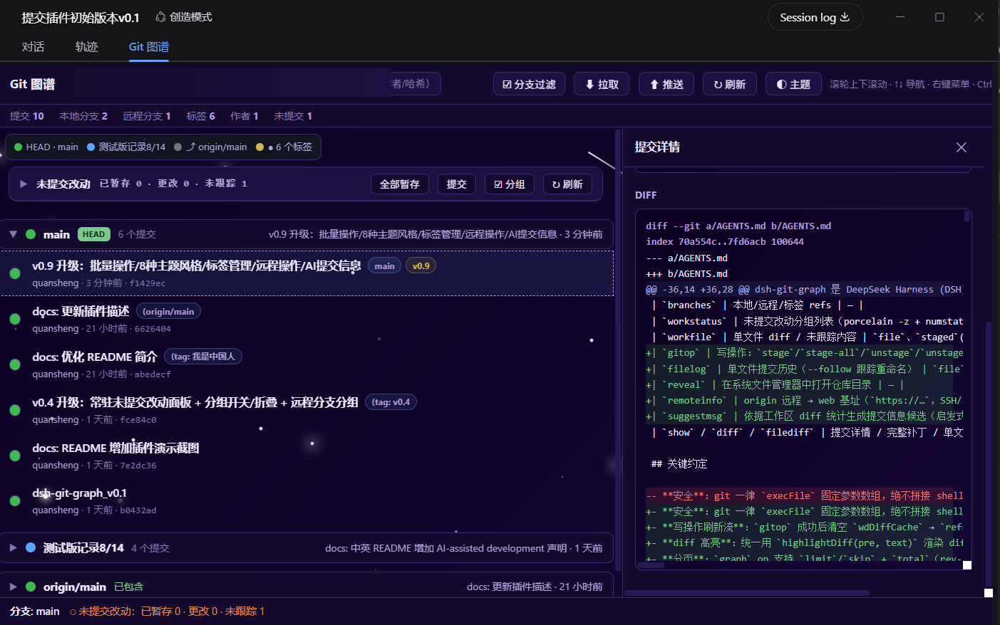

# dsh-git-graph

> 🧭 **A ready-to-use git visualizer for the DSH ecosystem.** An embedded git tool for the DeepSeek Harness (DSH) Web GUI: GitHub-style commit graph, branch management, code diffs, and a VSCode-style uncommitted changes panel — all inside your AI session, no need to switch to another git client.

An embedded git repository graph visualizer for the DeepSeek Harness (DSH) Web GUI.

View, browse and manage git repositories right inside the harness conversation — commit history graph, branch filtering, commit details, file diffs and working-tree changes, all embedded in the interface without leaving the current session. See at a glance what changed, who changed it, and whether to commit.

**Who it's for**: developers doing AI coding / agent development with DeepSeek Harness; git users who want commit history, branches and working-tree changes in one view; developers and teams looking for a more visual git tool than the command line.

> 🔍 Search keywords: DSH plugin · DeepSeek Harness plugin · git visualization · git graph · commit history · branch management · code diff · VSCode-style changes panel · git productivity tool · AI coding assistant

> 🛠 This plugin is developed with AI assistance.


## 📸 Preview



## ✨ Features

- **Commit history graph**: GitHub-style commit list with foldable per-branch groups and branch coloring (local and remote branches each get their own group)
- **Follows the current session**: shows the git repository of the workspace you are viewing; switching sessions follows automatically. Non-git workspaces show an empty state
- **Branch filtering**: checked = visible, unchecked = fully hidden (empty selection shows an empty list)
- **Commit details**: commit message, changed files, per-file diffs, compare two commits (Ctrl+click), 📜 file history (every commit touching a file)
- **Uncommitted changes (VSCode-style, persistent at the top of the graph)**: grouped file lists (Staged / Changes / Untracked), status badges (A/M/D/R/U/?), per-file +/− line counts, click-to-expand per-file diff (syntax highlighted), renames `old → new`, untracked file contents; the ☑ groups toggle hides any group, and both the panel and each group fold on click; **per-row stage/unstage/restore, top-bar stage-all/commit, checkboxes for batch actions (stage/unstage/restore/ignore/commit selected)** (destructive actions ask for confirmation first); the commit dialog can **✨ AI-generate a commit message** (heuristic candidates from the diff, editable)
- **Right-click menu**: copy hash/message, view details, 🏷️ tag a commit (rename/delete tags too), 🌿 create a branch from this commit, 🌐 open the GitHub commit page, copy repo path, open in file manager
- **Remote/branch operations**: top-bar `⬇ Fetch` (git fetch) and `⬆ Push` (git push current branch, confirmed first); branch-group right-click — local branches: 🔄 switch / ⬆ push / 🗑️ delete (merged-only, HEAD protected), remote branches: ⬇ fetch / copy remote branch name
- **Remote branches always visible**: remote group headers render even when fully synced with a local branch, labelled 「已同步」(synced) or 「已包含」(contained)
- **State memory**: branch filter, group toggles, fold states and theme persist across refreshes (keys unified to `gg2-*` since v0.8; branch groups are expanded by default on first open)
- **Multi-repo switching**: a dropdown at the top of the graph page switches between repos
- **Large-repo support**: the commit list loads in pages (200/page + load more)
- **Keyboard shortcuts**: `Ctrl+F` search, `Ctrl+/` shortcut panel, `Ctrl+B` fold/unfold all branch groups, `↑↓`/`j`/`k` navigation, `Enter` details, `Esc` close
- **Auto refresh**: while the page is visible it polls every 5s and updates the stats bar and list when the working tree or new commits change
- **Theme system**: auto-follow / dark / light, plus **8 style presets** (same set as 拾光记) — 🌸 sakura (falling petals), 🌊 ocean (waves/bubbles/fish), 🌲 forest (trees/leaves/fireflies/butterflies), 🌙 night (stars/moon/meteors), 🍬 candy (rainbow/ribbons/lollipops), 💼 business (geometric shapes/glass blocks), ✨ starry (stars/moon/meteors/earth), 🤖 tech (circuits/gears/chips), each with its own animated background (ocean/tech/business/candy have higher element density)
- **Mount point**: the "Git 图谱" tab inside the session pane (next to the trajectory tab)

## 📦 Installation

### 1. Add the plugin to your profile

Edit your DSH web profile's `package.json` and add the dependency:

```json
{
  "dependencies": {
    "dsh-git-graph": "file:./plugins/git-graph"
  }
}
```

(`plugins/git-graph` is the directory containing this plugin source; adjust the path as needed.)

### 2. Mount the bundle

Add the following to the profile's `cordis.patch.yml`:

```yaml
- insert:
    - id: git-graph
      name: dsh-git-graph
      config:
        repo: "C:/path/to/your/repo"
```

> `config.repo` / `config.repos` is the initial allowlist of repositories the graph panel may open; repositories discovered in the session workspace are added automatically at runtime.

### 3. Install and restart

```bash
pnpm install
# then restart dsh web
```

Open http://127.0.0.1:3080 and select the **Git 图谱** tab in any session.

## 🖱️ Usage

| Action | Description |
| --- | --- |
| "Git 图谱" tab in a session | Open the graph for the current session's workspace |
| Branch group header | Click to fold / unfold that branch |
| ☑ Branch filter | Checked = visible, unchecked = fully hidden |
| "未提交改动" block at the top of the graph | Staged / Changes / Untracked overview (incl. untracked files); click a file row to expand its diff; per-row stage/unstage/restore; batch actions via checkboxes |
| Commit row | Click for details; Ctrl+click to compare with another commit |
| Right-click a commit row | Copy / details / tag / create branch from commit / open GitHub commit page / copy repo path / open in file manager |
| "未提交改动" status line | Click to scroll to the top changes block |
| ↻ Refresh | Reload repository data |

## 🛠️ Development

```
git-graph/
├── index.js          # Server half: git API (graph/branches/workstatus/workfile/diff/...)
├── client.js         # Client half: "Git 图谱" session tab
├── web/index.html    # The graph page (standalone page inside an iframe)
├── package.json      # Plugin manifest (dsh.client.inject + bundle patch)
├── dsh.plugin.json   # Official DSH plugin manifest
└── cordis.patch.yml  # Profile mount point
```

After editing, sync to your DSH deployment directory (`node_modules/dsh-git-graph/`):

```powershell
.\sync-deploy.ps1 -Dst C:\path\to\your\.dsh\profiles\web\node_modules\dsh-git-graph
```

Server (`index.js`) and client (`client.js`) changes require a dsh web restart; `web/index.html` changes take effect after a page refresh. See `AGENTS.md` for full development conventions.

## 📄 License

[MIT](./LICENSE)

## 🙏 Acknowledgements

- [DeepSeek Harness](https://github.com/deepseek-ai/) — the plugin platform
